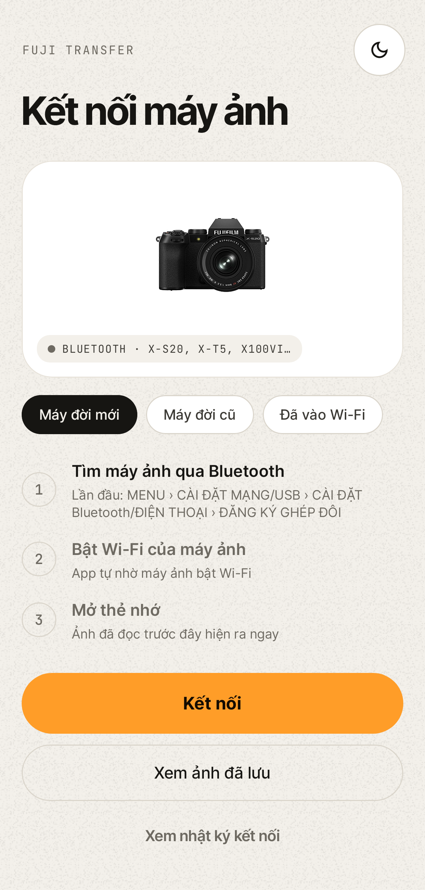
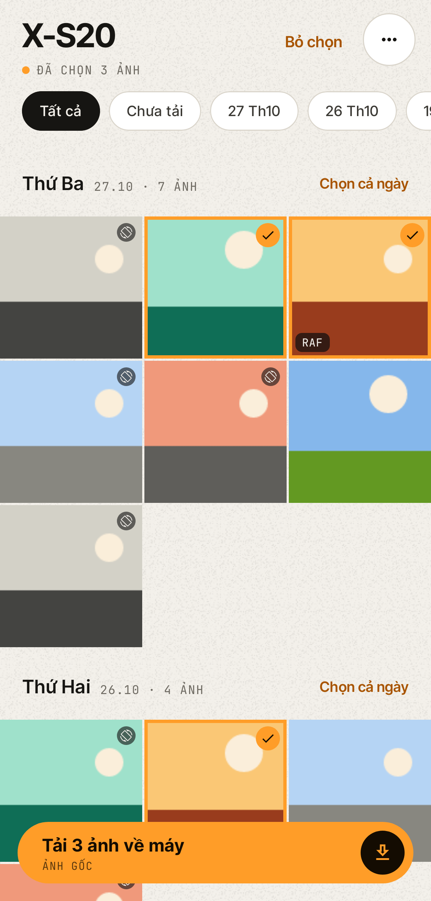
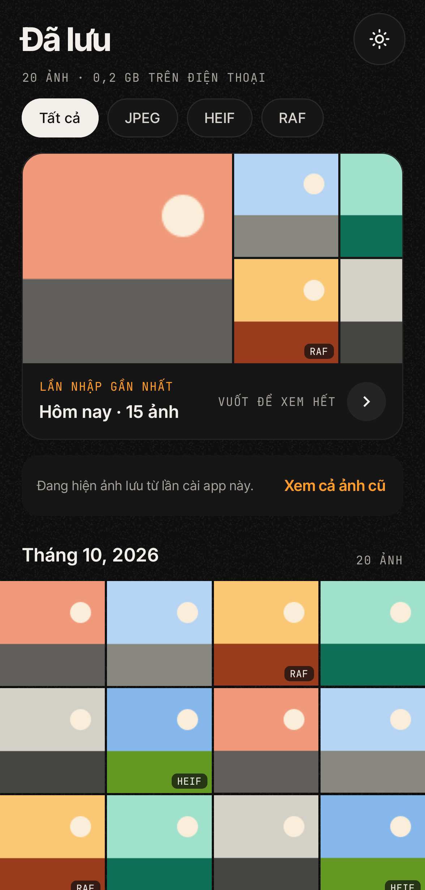
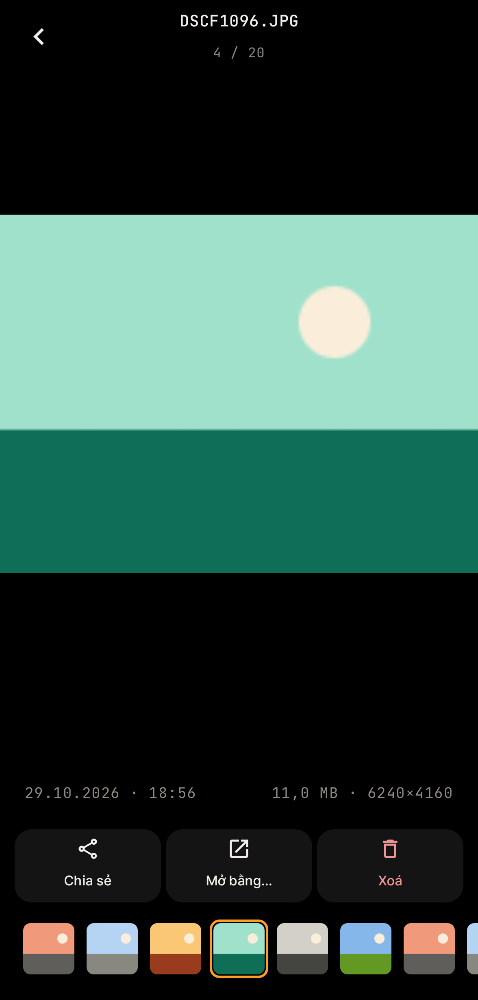

# Fuji Transfer

App Android chuyển ảnh từ máy ảnh Fujifilm X sang điện thoại qua Wi-Fi, thay cho FUJIFILM XApp. Đã dùng thật với X-S20; hỗ trợ cả máy đời mới (Bluetooth đánh thức Wi-Fi: X-S20, X-T5, X-H2, X100VI…) lẫn đời cũ (X-S10, X-T4, X100V…).

<p>
  
  
  
  
</p>

## Tính năng
- **Kết nối**: ghép đôi Bluetooth, nhờ máy ảnh bật Wi-Fi, tự vào mạng của máy; kết nối lại gần như tức thì.
- **Thư viện máy ảnh**: ảnh mới nhất trước, tải dần khi cuộn; lọc theo ngày, ẩn ảnh đã tải; ảnh thu nhỏ xoay đúng chiều, bỏ viền đen. Ngày chụp, hướng chụp và ảnh thu nhỏ được lưu lại nên các lần sau mở ra ngay.
- **Tải ảnh**: chọn từng ảnh, cả ngày hoặc "ảnh mới"; hỏi trước khi tải lại ảnh đã có; ảnh gốc hoặc cỡ S/XS do máy ảnh thu nhỏ; HEIF tự chuyển sang JPEG khi điện thoại không đọc được. Kiểm tra JPEG đủ đến byte cuối, không bao giờ giữ nửa tấm ảnh.
- **Chạy ngầm**: tiếp tục tải khi rời app, có thông báo tiến độ (Live Update trên Android 16) và nút Dừng; cửa sổ nổi dạng thanh dẹt hoặc bong bóng tròn.
- **Tab Đã lưu**: xem lại ảnh đã tải, vuốt qua lại, phóng to, lần nhập gần nhất, kéo để làm mới; RAF hiện bằng ảnh xem trước bên trong file.
- **Giao diện** sáng/tối, nền hạt film, màu nhấn cam.

## Cài đặt
Tải `FujiTransfer.apk` ở mục [Releases](../../releases), mở trên điện thoại và cho phép "cài ứng dụng không rõ nguồn gốc". Cần Android 10 trở lên.

## Dùng với máy đời mới (X-S20, X-T5, X-H2, X100VI…)
1. Lần đầu: trên máy ảnh vào MENU › CÀI ĐẶT MẠNG/USB › CÀI ĐẶT BLUETOOTH/ĐIỆN THOẠI › **ĐĂNG KÝ GHÉP ĐÔI**.
2. Trong app chọn **Máy đời mới** › **Kết nối**, xác nhận mã ghép đôi trên cả hai máy.
3. Android hỏi có vào mạng của máy ảnh không: chọn đồng ý. Các lần sau chỉ cần bật máy ảnh và bấm Kết nối.

## Dùng với máy đời cũ (X-S10, X-T4, X100V…)
1. Trên máy ảnh: bấm ▶ › MENU › **KẾT NỐI KHÔNG DÂY**.
2. Trong app bấm **Kết nối** và chọn mạng `FUJIFILM-…` (hoặc tự vào Wi-Fi máy ảnh rồi chọn "Đã vào Wi-Fi").
3. Bấm **OK** trên máy ảnh khi máy hỏi.

Ảnh được lưu vào `Pictures/Fuji Transfer`. Gặp lỗi: menu "…" › **Nhật ký kết nối** › **Chia sẻ**.

## Build
Cần JDK 17 và Android SDK 36.
```
./gradlew assembleRelease      # APK ở app/build/outputs/apk/release/
./gradlew testDebugUnitTest    # kiểm thử giao thức với máy ảnh giả, chụp màn hình giao diện
```

## Cấu trúc
- `protocol/FujiCamera.kt` — phiên làm việc với máy ảnh: bắt tay, chế độ XApp, liệt kê, ảnh thu nhỏ, tải ảnh (xử lý kích thước báo sai của X-S20)
- `protocol/PtpLink.kt`, `QueuedWriter.kt` — gói PTP qua TCP; ghi ảnh song song với lúc tải
- `FujiBluetooth.kt`, `CameraWifi.kt` — Bluetooth LE đánh thức Wi-Fi, vào mạng máy ảnh
- `MainViewModel.kt`, `MetadataCache.kt` — phiên kết nối, phân trang, cache thông tin và ảnh thu nhỏ
- `TransferService.kt`, `Bubble.kt`, `LiveUpdates.kt` — tải ngầm, thông báo, bong bóng nổi
- `SavedPhotos.kt`, `Thumbs.kt` — tab Đã lưu, cắt viền ảnh thu nhỏ, ảnh xem trước trong RAF
- `ui/` — giao diện Jetpack Compose

## Bản iOS
Mã nguồn Swift/SwiftUI ở thư mục [`ios/`](ios/), xem [ios/README.md](ios/README.md) để build trên máy Mac.

## Ghi chú
Giao thức dựa trên dự án mã nguồn mở [libfuji](https://github.com/petabyt/libfuji) (MIT). Phông chữ Inter Tight và JetBrains Mono theo giấy phép SIL OFL (`licenses/`). Ảnh máy X-S20 trên màn hình kết nối (`app/src/main/res/drawable-nodpi/camera_xs20.png`) lấy từ fujifilm-x.com và thuộc bản quyền FUJIFILM.

App này không liên kết với FUJIFILM. FUJIFILM, X-S20 và XApp là nhãn hiệu của FUJIFILM Corporation.
